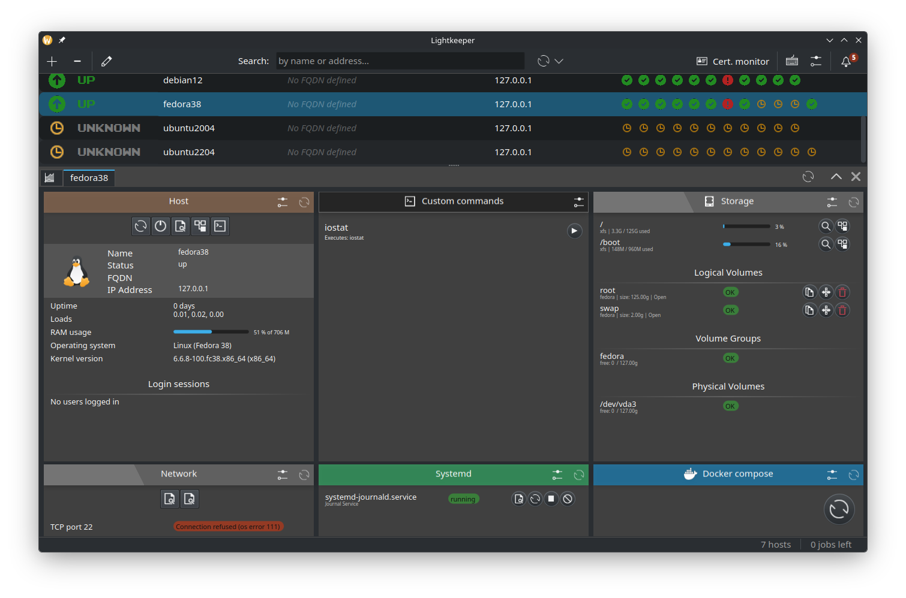
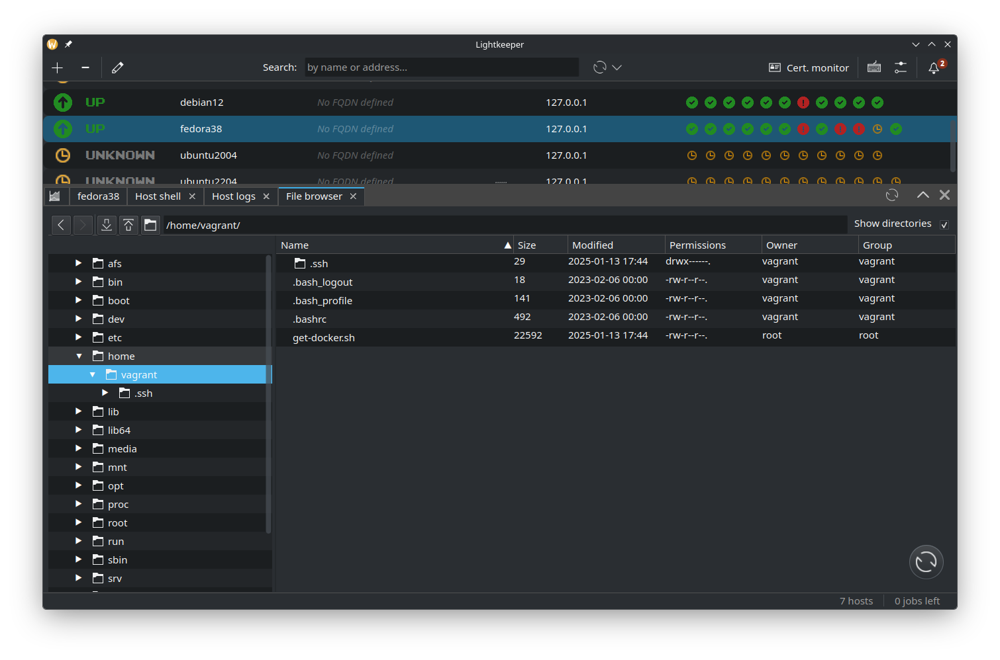
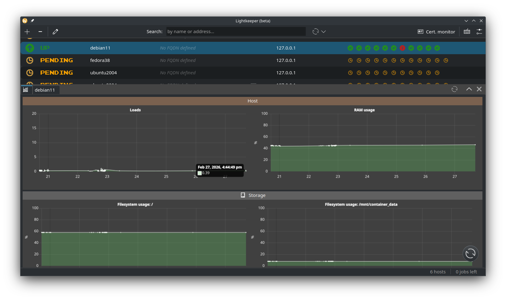
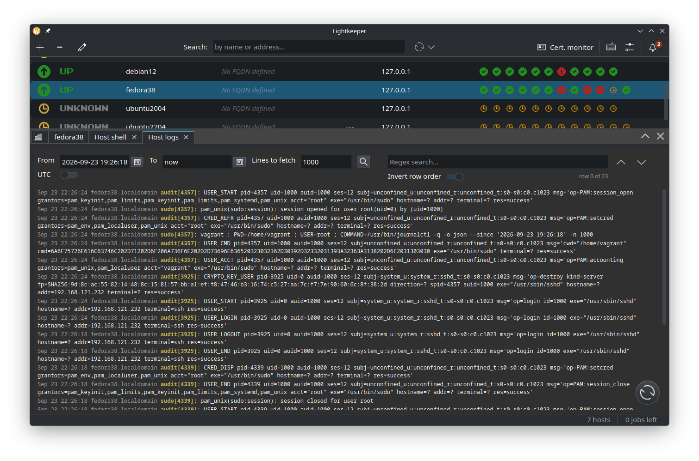
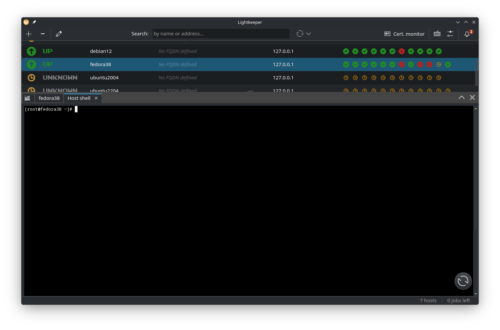
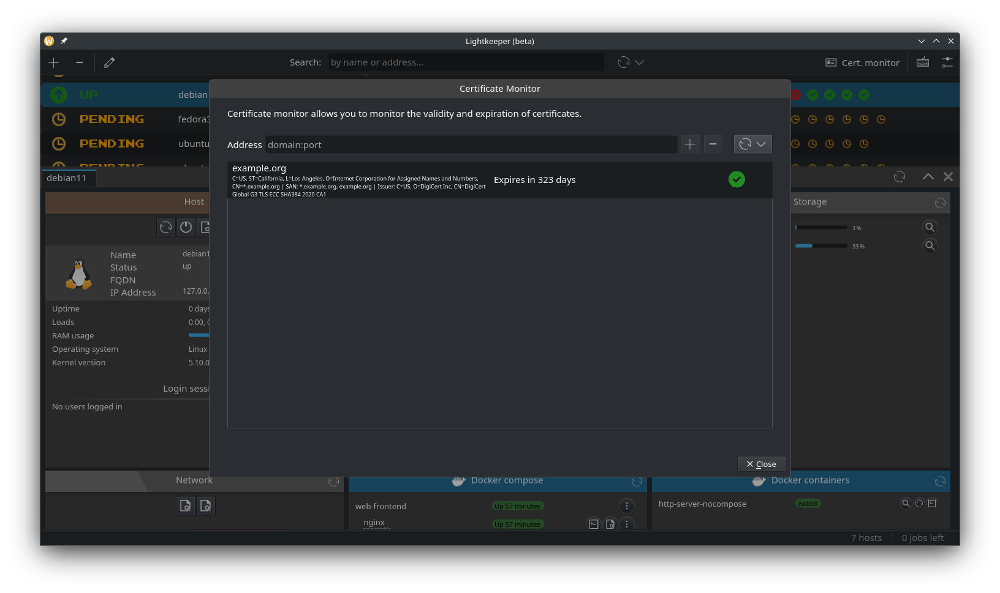

# Lightkeeper

Lightkeeper is a customizable server management and monitoring tool that works over SSH.
It gives a clear view of host resources and simplifies upgrades, monitoring, debugging, and configuration.

- **Agentless** - Uses standard Linux commands over SSH. No daemons or agents on the monitored host. Commands are easy to audit via debug log and host logs.
- **Keyboard shortcuts** - Extensive keyboard shortcuts. Press Ctrl-T for a terminal tab when you need the shell.
- **Modular** - Customizable and extendable for different workflows.

# Table of contents

- [Features](#features)
- [Why](#why)
- [Installing](#installing)
   - [Flatpak](#flatpak)
   - [Debian 14](#debian-14)
   - [Fedora 43/44](#fedora-4344)
- [Building from source](#building-from-source)
   - [Dependencies](#dependencies)
   - [Building](#building)
   - [Post-install](#post-install)
- [Server OS support](#server-os-support)
- [Configuration](#configuration)
   - [Configuration files](#configuration-files)
- [Remote core](#remote-core)
   - [Using remote core](#using-remote-core)
- [Debug logging](#debug-logging)
- [Testing](#testing)
- [License](#license)
   - [Lightkeeper](#lightkeeper)
   - [Crate dependencies](#crate-dependencies)
   - [Liboping](#liboping)

## Features
- Optional remote core: run the backend on another host so monitoring can continue while the GUI is closed.
- Monitor status changes periodically and get alert notifications.
- Monitor certificate validity and expiration.
- Status summary in host table for quick status view.
- Charts for visualizing historical values.
- Integrated terminal (Ctrl-T opens a new tab).
- File browser for remote files.
- Log viewer with regex search and hotkeys similar to less/vim.
- Text file editor for editing remote files (with built-in editor or using CLI over SSH).
- Follow console output for longer running commands such as container builds and package updates.

## Why
Repeating the same SSH commands gets tiresome, even with shell history.
A full monitoring stack (CollectD, InfluxDB, Grafana etc.) is often heavier and more complicated than needed for graphs and alerts.

Lightkeeper is meant for power users who want that workflow without installing agents or extra daemons on the servers.

<table>
  <tr>
    <td width="50%" align="center" valign="top">
      <br />
      <em>Overview</em>
    </td>
    <td width="50%" align="center" valign="top">
      <br />
      <em>File browser</em>
    </td>
  </tr>
  <tr>
    <td width="50%" align="center" valign="top">
      <br />
      <em>Charts</em>
    </td>
    <td width="50%" align="center" valign="top">
      <br />
      <em>Log viewer</em>
    </td>
  </tr>
  <tr>
    <td width="50%" align="center" valign="top">
      <br />
      <em>Terminal</em>
    </td>
    <td width="50%" align="center" valign="top">
      <br />
      <em>Certificate monitoring</em>
    </td>
  </tr>
</table>

# Installing
## Flatpak

This is the recommended install method. Uses sandboxing and minimum amount of permissions required.  
Install from Flathub: https://flathub.org/apps/io.github.kalaksi.Lightkeeper  

To build a Flatpak bundle locally, see [flatpak/README.md](flatpak/README.md).

## Debian 14

Download `.deb` packages from the [GitHub Releases](https://github.com/kalaksi/lightkeeper/releases) page.

To build `.deb` packages locally, see [packaging/debian/README.md](packaging/debian/README.md).

## Fedora 43/44

Download `.rpm` packages from the [GitHub Releases](https://github.com/kalaksi/lightkeeper/releases) page.

To build RPM packages locally, see [packaging/fedora/README.md](packaging/fedora/README.md).

# Building from source
## Dependencies
- Qt 6.10
- Rust **1.88** or newer (`rustc` / `cargo`; see `rust-version` in `Cargo.toml`).

Exact development package names differ by distribution. See
[packaging/debian/README.md](packaging/debian/README.md) and
[packaging/fedora/README.md](packaging/fedora/README.md) for lists used on Debian and Fedora.

QtWebEngine is not strictly required, but needed for proper integrated text editor.

## Building
Clone the repository with submodules (needed for bundled QML components and packaging scripts):

```
git clone --recurse-submodules https://github.com/kalaksi/lightkeeper.git
cd lightkeeper
```

For development, run this in repo root:
```
./build.sh
```

For running:
```
./run.sh
```

If you're getting error about missing qmake, you'll have to point cargo to correct qmake with .cargo/config.toml:
```
[env]
QMAKE = "/usr/lib/qt6/bin/qmake"
```

## Post-install

If you're using the ping monitor (not used by default), you need to give Lightkeeper binary more networking privileges:
```
$ setcap cap_net_raw+ep $MY_BINARY
```

# Server OS support
The (current) goal is to support:
- Debian
- Ubuntu
- RHEL
- CentOS, AlmaLinux, Rocky
- Amazon Linux
- NixOS
- Fedora
- Fedora CoreOS
- Alpine
- Linux in general (basic functionality for most distributions)


# Configuration
**NOTE: Some commands need higher privileges. Those commands assume sudo is available and requires no password input. You can disallow sudo in host settings and those commands will be skipped.**  
  
Configuration can be done using the graphical UI or by editing configuration files.

## Configuration files
Example configuration files `config.example.yml`, `hosts.example.yml` and `groups.example.yml` can be found in the root of this repository.

When running without flatpak, the default configuration directory is usually `~/.config/lightkeeper`.
With flatpak, it's the usual app specific directory `~/.var/app/io.github.kalaksi.Lightkeeper/config`.
You can use a custom configuration directory with the `-c`/`--config-dir` option.

# Remote core
By default, in the local mode, the monitoring backend runs in the desktop app.
You can instead run `lightkeeper-core` on another host (typically a jump host or always-on server that can reach your monitored hosts) and use the desktop app only as the UI.

Monitoring, alerts, and charts keep running on the core host while the GUI is closed.
Managed hosts stay agentless and `lightkeeper-core` reaches them over SSH the same way local mode does.

`lightkeeper-core` listens on a Unix socket, not a network port. The desktop connects to that socket over SSH.

## Using remote core
Open the Lightkeeper Core dialog from the toolbar, enter SSH settings for the core host, and use Check to probe it.
If the binary is missing, Install can place `lightkeeper-core` as a systemd user service under that account (`~/.local/bin` and a user unit).
Then Connect. You can also enable automatic connect on startup.

Alternatively, run the published container image. An example compose file is in
[packaging/lightkeeper-core/docker-compose.yml](packaging/lightkeeper-core/docker-compose.yml).
With a container, set Socket path in the dialog to the absolute host path of `core.sock`.

Release binaries for `lightkeeper-core` are attached to
[GitHub Releases](https://github.com/kalaksi/lightkeeper/releases).

**NOTE: Configuration and secrets for managed hosts live on the core host.**

# Debug logging
Log levels are controlled with environment variable `RUST_LOG`, so use `RUST_LOG=debug`.


# Testing

Tests are still a work-in-progress, but you can run them with:
```
cargo test
```
  
Also, `test-env`-directory contains Vagrantfiles for virtual machines and also matching configurations for testing.  
You can use `--config-dir` to load the test configuration for manual testing. For example, `./target/debug/lightkeeper --config-dir test` if building from source.  


# License
## Lightkeeper
Copyright © 2023 kalaksi@users.noreply.github.com.  
  
This software is licensed under GNU Affero General Public License 3 or later.  
**Dual-licensing is possible if your organization needs something else than AGPL. Get in contact.**  


## Crate dependencies
All crate dependencies contain permissive licenses (mostly MIT license).  
You can check the licenses with:
```
cargo tree --format "{p} {l}" --prefix none
```

Or, to quickly see what different licenses are being used by printing only unique license strings:
```
cargo tree --format "{l}" --prefix none | sort | uniq
```

## Liboping
Liboping 1.10 (https://noping.cc/) is redistributed inside the flatpak package.
It's a separate C library dependency needed by oping-crate and is distributed under LGPL-2.1 license.
